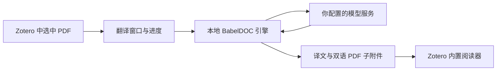

# BabelDOC for Zotero

这个插件把 [BabelDOC](https://github.com/funstory-ai/BabelDOC) 接到 Zotero。选中论文的 PDF 后，你可以在 Zotero 里翻译它，把译文和双语对照保存为文献附件，再用内置阅读器打开。原 PDF 会保留，生成的文档保留原有布局。

[English](README.en.md) · [下载](https://github.com/ptiris/zotero-babeldoc/releases/latest) · [安装说明](docs/installation.md) · [常见问题](docs/troubleshooting.md) · [报告问题](https://github.com/ptiris/zotero-babeldoc/issues)

[](https://github.com/ptiris/zotero-babeldoc/actions/workflows/ci.yml)
[](LICENSE)

翻译入口在文献右键菜单、工具菜单和 PDF 阅读器的 "译" 按钮里。窗口中可以设置模型、语言、页码、请求速率和 OCR，也可以查看进度或取消任务。输出可选译文、双语对照或两者；双语版支持左右并排和交替页。

多选 PDF 时，插件会依次翻译。结果放在原文献下；独立 PDF 的结果保留原分类。如果生成成功但保存附件失败，插件会留下结果文件，方便手动导入。



## 安装和使用

插件需要单独安装 BabelDOC 引擎，并使用你配置的 OpenAI Chat Completions 兼容服务。你需要自己的模型账号或本地模型服务，API 费用由服务商计收。插件没有内置翻译额度。

1. 从 [Releases](https://github.com/ptiris/zotero-babeldoc/releases/latest) 下载 `zotero-babeldoc-版本.xpi` 和 `zotero-babeldoc-版本-source.zip`。
2. 在 Zotero 的工具 → 插件中，点齿轮 → 从文件安装插件，选择 XPI。
3. 解压源码包。macOS 运行 `install-macos.command`，Windows 运行 `install-windows.cmd`，Linux 运行 `python3 scripts/install-engine.py`。建议先安装 [uv](https://docs.astral.sh/uv/getting-started/installation/)。
4. 选中 PDF，右键打开 "BabelDOC 翻译 PDF…"，填入安装器打印的 Python 完整路径，点 "检查环境"。
5. 填写 API 地址、模型名称和 API Key，然后开始翻译。默认英文译成中文，完成后打开双语 PDF。

第一次翻译会下载版面模型和字体，初始化可能需要一些时间。安装细节见 [安装与升级](docs/installation.md)，各字段的填写方式见 [配置说明](docs/configuration.md)。文档和密钥如何处理，见 [数据与隐私](docs/privacy.md)。

## 支持的环境

插件清单允许安装到 Zotero 7.0 至 10.0.*，不支持 Zotero 6。引擎固定为 BabelDOC 0.6.4，Python 支持 3.10 至 3.13，建议使用 3.12。

目前完成桌面测试的环境是 macOS Apple Silicon、Zotero 10.0.6 和 Python 3.12.14。安装、真实 BabelDOC 翻译、附件导入和内置阅读器展示都已检查。测试用的是本地模拟模型，验证的是接入流程，不能说明真实模型的翻译质量。

Windows 和 Linux 有安装入口，但还没有做桌面集成测试；Zotero 7 至 9 也尚未实测。具体记录在 [验证说明](docs/validation.md)。

## 版本和升级

仓库当前版本是 0.1.2。翻译代码沿用已验证的 0.1.1，增加了 GitHub 发布、自动更新和仓库工具，兼容上限调整为 10.0.*。

此前本地交付的 0.1.1 使用 `.invalid` 更新地址，需要手动安装一次 GitHub 版 0.1.2。原有插件 ID 和设置会保留。之后 Zotero 可以通过固定更新清单检查后续稳定版。

Python 引擎独立安装，不随 XPI 自动更新，当前仍使用 BabelDOC 0.6.4。各版本的改动见 [版本记录](CHANGELOG.md)。

## 开发

```bash
node --test tests/test_controller.cjs
python3 -m unittest discover -s tests -p 'test_build.py' -v
python3 scripts/install-engine.py
# macOS/Linux；Windows 使用 engine\Scripts\python.exe
engine/bin/python -m unittest discover -s tests -v
python3 scripts/build.py --repository ptiris/zotero-babeldoc
```

构建产物在 `dist/`。源码包只包含 Git 跟踪的文件，新增文件要先 `git add`。测试用到 Node.js，但没有 npm 依赖；插件也不需要常驻的本地 HTTP 服务。

[开发指南](docs/development.md) 包含测试步骤和可选的真实引擎冒烟测试。其他开发资料：

- [架构与协议](docs/architecture.md)
- [贡献说明](CONTRIBUTING.md)
- [用 gh 管理仓库、发布与自动更新](docs/publishing.md)
- [安全问题报告](SECURITY.md)

## 许可和参考

本项目使用 [AGPL-3.0-or-later](LICENSE)。BabelDOC 独立安装，依赖说明见 [第三方项目](THIRD_PARTY_NOTICES.md)。这是社区插件，与 Zotero、BabelDOC 官方无隶属关系。

感谢 Zotero、BabelDOC 和 Zotero 插件社区。仓库文档与发布流程参考了 Plugin Template、Better Notes 和 PDF2zh，来源列在 [参考仓库](docs/references.md)。
